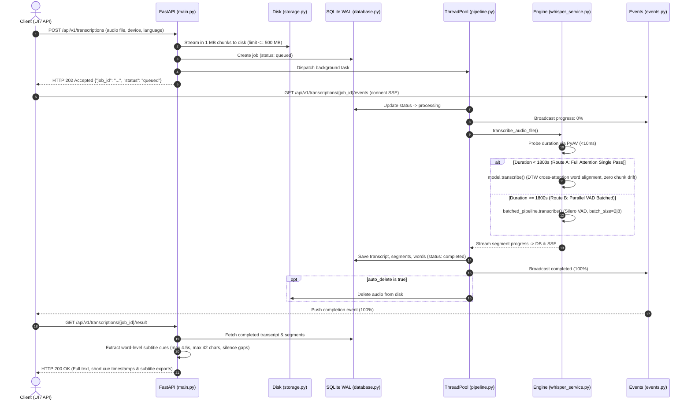

# 🎙️ Whisper Audio Transcription Microservice

A high-performance audio transcription microservice and interactive studio powered by **FastAPI** and **Faster-Whisper (CTranslate2)**.

Features zero external dependencies (no Redis, no Celery), built-in CPU/GPU acceleration, real-time Server-Sent Events (SSE) tracking, acoustic silence chunking, and instant subtitle exports.

---

## 📑 Table of Contents
- [Architecture & Execution Flow](#-architecture--execution-flow)
- [Codebase Structure](#-codebase-structure)
- [Acoustic Chunking & High-Precision Alignment](#-acoustic-chunking--high-precision-alignment)
- [Smart Word-Level Subtitle Formatting](#-smart-word-level-subtitle-formatting)
- [Model & Quantization](#-model--quantization)
- [Quick Start](#-quick-start)
- [Interactive Web UI](#-interactive-web-ui)
- [REST API Reference](#-rest-api-reference)
- [Configuration](#-configuration)
- [Memory Management & Fault Recovery](#-memory-management--fault-recovery)

---

## 🔄 Architecture & Execution Flow



### Pipeline Summary
1. **$O(1)$ Memory Upload:** Streamed in 1 MB chunks directly to disk; rejects files over 500 MB with `HTTP 413`.
2. **Instant Handshake:** Validates format, records job in SQLite WAL, and returns `HTTP 202` in $<100\text{ms}$.
3. **Isolated Thread Pool:** Background jobs run on `ThreadPoolExecutor(max_workers=1)` to prevent CPU event-loop starvation.
4. **PyAV Pre-flight Probe:** Inspects container metadata in $<10\text{ms}$ to route audio length.
5. **Exact Word Alignment:** Uses native Dynamic Time Warping (DTW) for audio $<30$ min, preventing batch-slicing timestamp drift.
6. **Smart Subtitle Formatting:** Generates clean, broadcast-standard subtitle cards (max 4.5s) that disappear during silence gaps.
7. **Real-Time Push & Export:** Progress broadcasts over SSE; outputs formatted `.srt`, `.vtt`, and `.json`.

---

## 📁 Codebase Structure

```text
Audio_Voice_Transcription/
├── main.py              # FastAPI app, lifespan setup & REST endpoints
├── config.py            # Environment variables, constants & defaults
├── whisper_service.py   # Model caching, PyAV probe, VAD inference & memory retry
├── pipeline.py          # Bounded ThreadPool worker & async pipeline runner
├── database.py          # SQLite WAL connection & atomic job CRUD
├── events.py            # SSE pub/sub broker with 15s keepalive ping
├── storage.py           # 1 MB chunked streaming upload & cleanup
├── subtitles.py         # SubRip (.srt) and WebVTT (.vtt) formatters
├── ui.py                # Single-page studio UI (Tailwind CSS, recorder, player)
├── requirements.txt     # Python dependencies
└── storage/             # Model weights, database & temporary uploads
```

| Module | Role | Key Functions / Responsibilities |
| :--- | :--- | :--- |
| `main.py` | API Gateway | Endpoints for upload, status, SSE stream, result, and subtitle download |
| `config.py` | Settings | Paths, `CHUNK_MIN_DURATION_SEC` (300s), `MAX_UPLOAD_SIZE_BYTES` (500 MB) |
| `whisper_service.py` | Inference Engine | `probe_audio_duration`, `get_whisper_model`, `transcribe_audio_file`, `clear_model_memory` |
| `pipeline.py` | Task Queue | `inference_pool` (`max_workers=1`), `_transcribe_worker` |
| `database.py` | Persistence | SQLite WAL mode, `db_create_job`, `db_update_progress`, `db_complete_job` |
| `events.py` | Live SSE Broker | `subscribe_job`, `broadcast_job_event`, `job_event_generator` (15s heartbeat) |
| `storage.py` | File I/O | `save_upload_file` (1 MB streaming chunks, 500 MB limit), `cleanup_file` |
| `subtitles.py` | Subtitle Export | `to_srt` (HH:MM:SS,mmm), `to_vtt` (HH:MM:SS.mmm) |
| `ui.py` | Studio UI | Audio drag-and-drop, in-browser player, microphone recorder, live SSE bar |

---

## ⚡ Acoustic Chunking & High-Precision Alignment

### Why Clock Slicing Fails vs Silero VAD
- **Fixed Clock Slicing (e.g. every 30s):** Cuts words in half mid-phoneme (e.g., `trans-` / `-cription`). This forces Whisper's autoregressive decoder into hallucination loops and broken timestamps.
- **Silero VAD Silence Chunking:** Slices audio strictly at natural breath and speech pauses ($>500\text{ms}$ silence gaps). Words and phonemes remain 100% intact.

### 30-Minute Dual-Route Architecture
| Route | Condition | Engine Path | Rationale |
| :--- | :--- | :--- | :--- |
| **Route A (High Precision)** | `< 30 min` ($< 1800\text{s}$) | `model.transcribe()` | Single continuous pass with Dynamic Time Warping (DTW) word alignment. Prevents batch slicing drift and provides millisecond-accurate word boundaries. |
| **Route B (Parallel Batch)** | `≥ 30 min` ($\ge 1800\text{s}$) | `batched_pipeline.transcribe()` | Slices at VAD pauses and infers in parallel batches (`batch_size=2` CPU, `8` GPU) for ultra-long audio files. |

### Custom VAD Edge-Protection Parameters
```python
vad_parameters = dict(
    min_speech_duration_ms=100,  # Lowered from 250ms to catch short words ("Hi", "Yes", "No")
    speech_pad_ms=300,           # 300ms buffer before/after speech to protect plosive consonants
    threshold=0.4                # Lowered from 0.5 to detect soft/low-gain voices
)
```

---

## 📝 Smart Word-Level Subtitle Formatting

Whisper natively outputs coarse 30-second acoustic windows. The service includes a word-level subtitle formatter in [`subtitles.py`](subtitles.py) that automatically transforms raw model output into readable, broadcast-standard subtitle cards:

### Formatting Rules
1. **Length Cap:** Max **42 characters** (or ~8 words) per subtitle cue to prevent visual clutter.
2. **Duration Ceiling:** Hard-limits any individual subtitle cue to **4.5 seconds**.
3. **Punctuation Splitting:** Breaks cues immediately at terminal punctuation marks (`.`, `?`, `!`, `,`, `;`, `:`).
4. **Silence Gaps & Clean Screen:** Breaks cues whenever a speech pause $\ge 0.5\text{s}$ occurs between words. Subtitles **disappear completely during pauses**, leaving the video screen clean.

```srt
1
00:00:01,360 --> 00:00:02,180
Look Jeff,

2
00:00:06,050 --> 00:00:09,270
glad to see things are going well and
```
*(Notice: Between `00:00:02,180` and `00:00:06,050`, there is a 3.87-second pause where no subtitle is displayed).*

---

## 🧠 Model & Quantization

- **CPU (Default):** Quantized to **INT8** (`compute_type="int8"`). Uses 70% less RAM (<600 MB) and runs 4x faster than FP32.
- **GPU (CUDA):** Half-precision **FP16** (`compute_type="float16"`). Auto-detected on startup; falls back to CPU if unavailable.
- **Default Local Weights:** Loaded from `storage/model/` (Faster-Whisper `base` model, ~145 MB).
- **Model Source / Download:** Downloaded from Hugging Face repository: [Systran/faster-whisper-base](https://huggingface.co/Systran/faster-whisper-base) (`https://huggingface.co/Systran/faster-whisper-base`).

---

## 📦 Quick Start

### Option A: Local Python

```bash
# 1. Setup virtual environment
python -m venv .venv
.venv\Scripts\Activate.ps1       # On Linux/macOS: source .venv/bin/activate

# 2. Install dependencies
pip install -r requirements.txt

# 3. Start service
python main.py
```

### Option B: Docker

```bash
# 1. Build Docker image
docker build -t whisper-transcription .

# 2. Run container (persisting storage for models & DB)
docker run -d -p 8000:8000 -v $(pwd)/storage:/app/storage --name whisper-app whisper-transcription
```

- **Web Studio UI:** `http://localhost:8000`
- **Swagger API Docs:** `http://localhost:8000/docs`

---

## 🎨 Interactive Web UI

Open `http://localhost:8000` for the built-in studio:
- **Audio Preview:** In-browser player (`<audio controls>`) with file info.
- **Microphone Recorder:** Record 16 kHz audio directly in the browser.
- **Hardware Selector:** Toggle between CPU (int8) and GPU (float16).
- **Live Progress:** Real-time progress bar powered by SSE (`12:30 / 60:00 · 21%`).
- **Instant Export:** One-click downloads for **SRT**, **VTT**, and **JSON**.

---

## 🔌 REST API Reference

### 1. Submit Audio
`POST /api/v1/transcriptions` (Returns `202 Accepted`)
```bash
curl -X POST "http://localhost:8000/api/v1/transcriptions" \
  -F "file=@sample.mp3" \
  -F "device=cpu" \
  -F "language=en"
```

### 2. Stream Live Progress (SSE)
`GET /api/v1/transcriptions/{job_id}/events`
```bash
curl -N "http://localhost:8000/api/v1/transcriptions/{job_id}/events"
```

### 3. Get Result
`GET /api/v1/transcriptions/{job_id}/result`

### 4. Download Subtitles
`GET /api/v1/transcriptions/{job_id}/download?format=srt` (`srt`, `vtt`, or `json`)

---

## ⚙️ Configuration

Set via environment variables or edit `config.py`:

| Variable | Default | Description |
| :--- | :--- | :--- |
| `STORAGE_DIR` | `./storage` | Directory for DB, uploads, and model cache |
| `WHISPER_MODEL` | `storage/model` | Path to local model folder or HuggingFace ID |
| `WHISPER_CPU_THREADS` | `2` | Worker threads per CTranslate2 instance |
| `CHUNK_MIN_DURATION_SEC` | `1800.0` | Minimum seconds to trigger parallel VAD batching (30 min) |
| `MAX_UPLOAD_SIZE_BYTES` | `524288000` | Upload limit in bytes (500 MB) |
| `MAX_CONCURRENT_JOBS` | `1` | Max concurrent inference jobs |
| `AUTO_DELETE_AUDIO` | `true` | Delete audio file after transcription |

---

## 🛡️ Memory Management & Fault Recovery

1. **Windows Intel MKL Shield:** Sets `CT2_USE_MKL="0"` and `MKL_NUM_THREADS="1"` at startup to prevent `mkl_malloc: failed to allocate memory` errors under memory pressure.
2. **Auto-Recovery Retry:** On memory errors, the engine calls `clear_model_memory()` (`gc.collect()`, cache flush) and retries transcription with a minimal thread footprint.
3. **SSE Keepalive:** Emits `: keepalive\n\n` comments every 15 seconds to prevent browser and reverse proxy timeouts.
